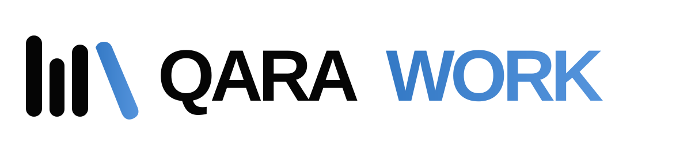
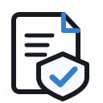

# Make regulated software work.

**Open tools for regulated software teams.**

Requirements, traceability, change control and quality evidence, connected to the tools you already use.

 

**Choose a tool. Explore what it does. Start with what you need.**

[Explore the MCP toolkit](#explore-the-toolkit) &nbsp; · &nbsp; [Our approach](#simple-for-teams-rigorous-by-design)

 

Created by <a href="https://github.com/alexandra-bonnet">Alexandra Bonnet</a>

---

## Explore the toolkit

**Six focused MCP products. One goal: make regulated software work.**

<table>
<tr>
<td width="50%" valign="top">

**Connect requirements to code and evidence.**

Link Notion and GitHub, detect traceability gaps and prepare change-impact drafts.

**Available**

**[Explore Traceability →](tools/traceability/README.md)**

</td>
<td width="50%" valign="top">

**Keep the right revision in use.**

Check review status, spot missing approval evidence and detect file changes.

**Available**

**[Explore Document Control →](tools/document-control/README.md)**

</td>
</tr>
<tr>
<td valign="top">

**Know what changed, when and by whom.**

Review activity evidence and identify gaps in change history.

**Available**

**[Explore Audit Trail →](tools/audit-trail/README.md)**

</td>
<td valign="top">

**Check who can do what.**

Detect mismatches between defined roles and effective access rights.

**In design**

**[Explore Access Control →](tools/access-control/README.md)**

</td>
</tr>
<tr>
<td valign="top">

**Keep evidence accessible.**

Check retention rules, missing records and archived evidence.

**In design**

**[Explore Records & Retention →](tools/records-retention/README.md)**

</td>
<td valign="top">

**Know when approved evidence changes.**

Compare evidence fingerprints with protected reference baselines.

**In design**

**[Explore Evidence Integrity →](tools/evidence-integrity/README.md)**

</td>
</tr>
</table>

Available tools are open-source prototypes. In-design tools are not yet implemented. Suitability and validation depend on intended use and deployment.

## Simple for teams. Rigorous by design.

**Keep your tools. Keep your people in control. Make the evidence visible.**

<table>
<tr>
<td width="33%" valign="top"><h3>Connect</h3>
Bridge the systems where requirements, code and evidence already live.
</td>
<td width="33%" valign="top"><h3>Control</h3>
Verify revision states and prerequisites for human reviews and approvals.
</td>
<td width="34%" valign="top"><h3>Demonstrate</h3>
Report gaps, preserve traceable references and support reproducible verification.
</td>
</tr>
</table>

**Human decisions remain human.** AI may prepare analysis, but it cannot grant QARA approval. MCP checks can detect gaps; reliable access enforcement, independent audit records, retention and approvals need appropriate system and procedural controls.

---

**Make regulated software work.**

QARAWORK · Created by [Alexandra Bonnet](https://github.com/alexandra-bonnet)

These tools support quality and engineering workflows. They do not themselves provide a validated eQMS, electronic signatures, or proof of ISO 13485 conformity. Suitability and validation depend on the intended use and implementation.

